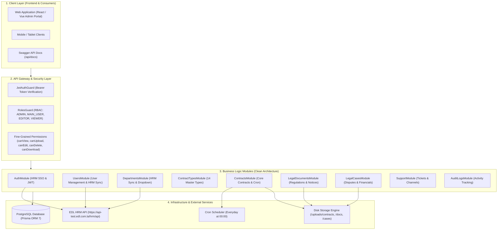
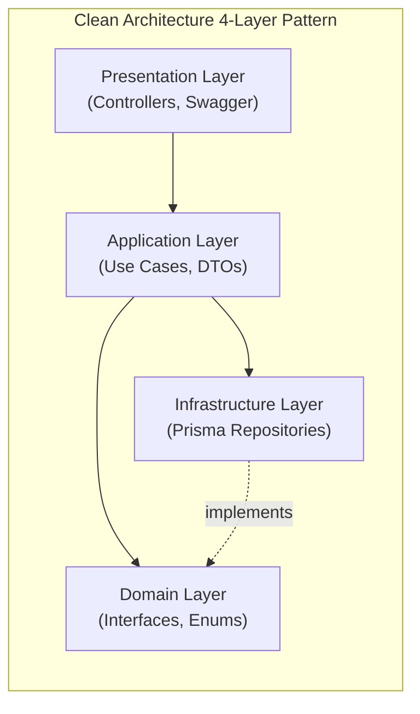
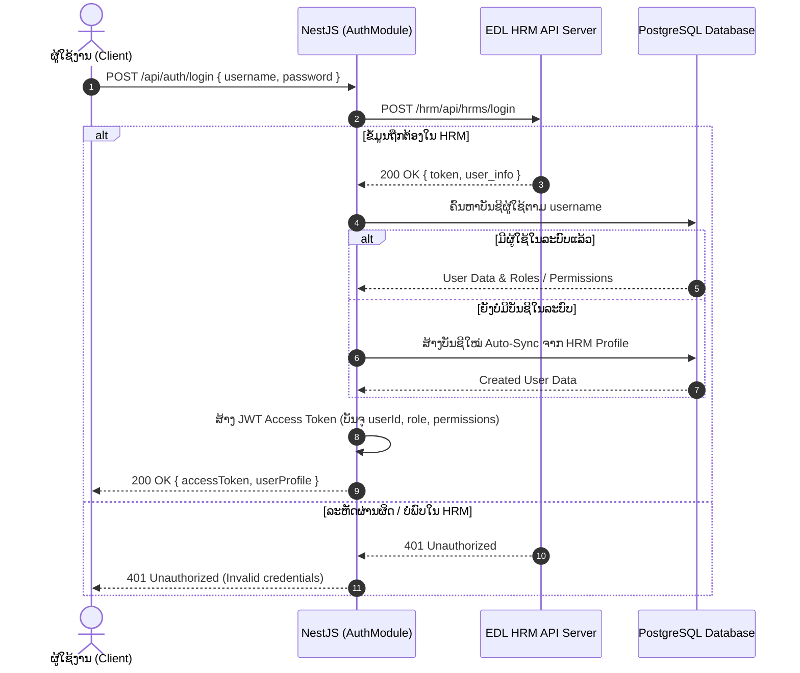
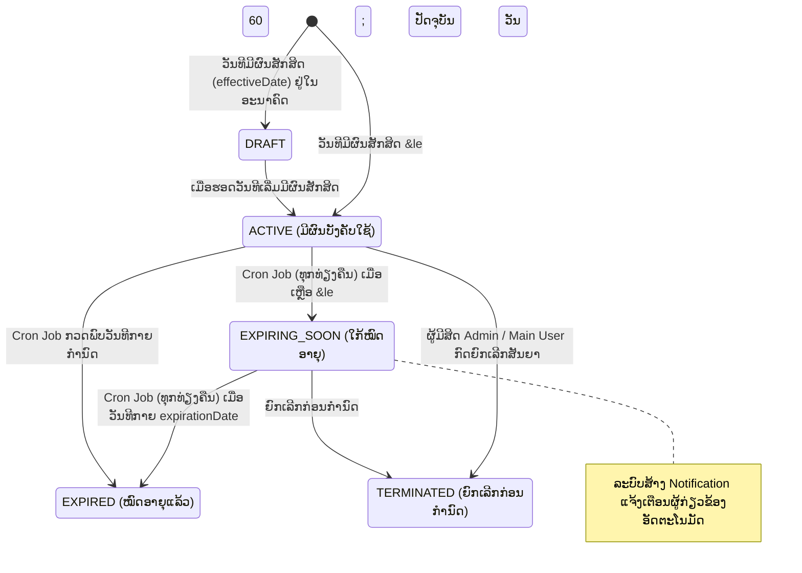
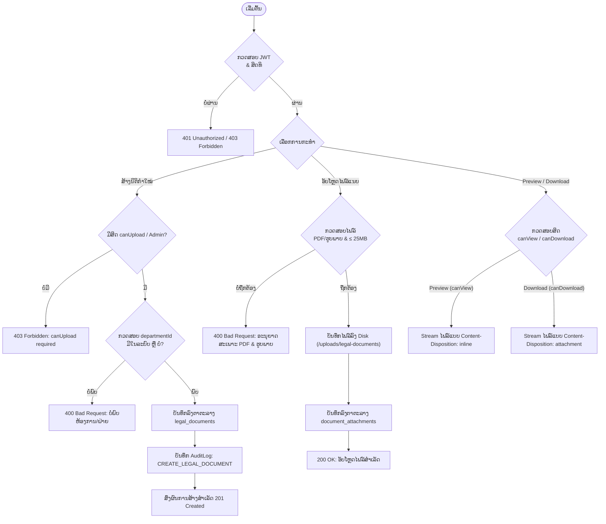
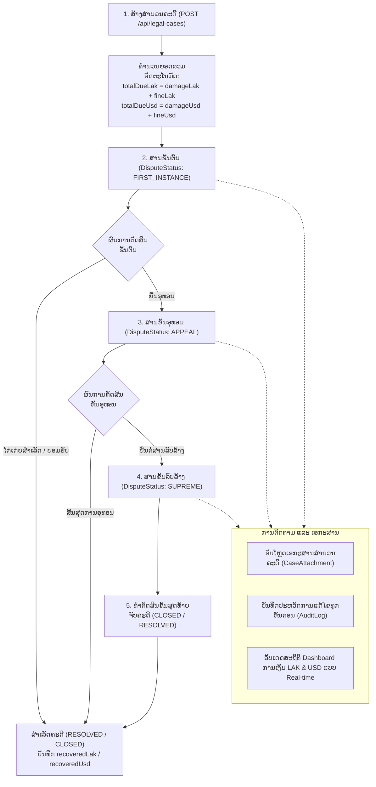
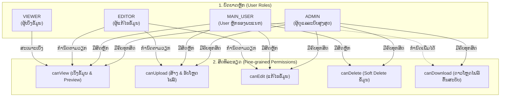
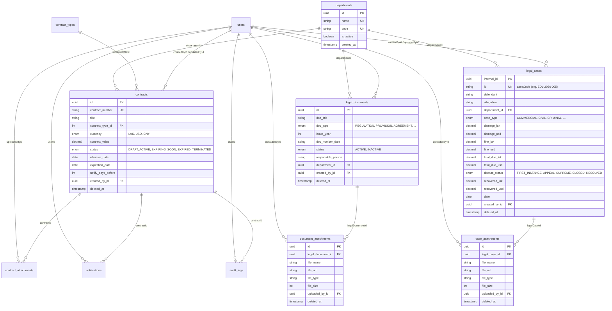

# ລະບົບຄຸ້ມຄອງສັນຍາ, ນິຕິກຳ ແລະ ຄະດີຄວາມ ໄຟຟ້າລາວ (EDL)
## System Architecture, Workflows & Module Specification

---

## 1. ພາບລວມລະບົບ (System Overview)

ລະບົບຄຸ້ມຄອງວຽກງານກົດໝາຍ ຂອງ **ລັດວິສາຫະກິດໄຟຟ້າລາວ (EDL)** ເປັນລະບົບ Backend ທີ່ພັດທະນາດ້ວຍ **NestJS (Node.js ESM + TypeScript)**, **Prisma ORM 7** ແລະ **PostgreSQL** ພາຍໃຕ້ສະຖາປັດຕະຍະກຳ **Clean Architecture (4 Layers)**.

ລະບົບແບ່ງອອກເປັນ **3 ພາກສ່ວນຫຼັກ (Core Pillars)** ຕາມໂຄງສ້າງການຈັດຕັ້ງ:
1. **ພະແນກສັນຍາທົ່ວໄປ (General Contracts Division)**: ຕິດຕາມສັນຍາ 14 ປະເພດ, ແຈ້ງເຕືອນສັນຍາໃກ້ໝົດອາຍຸ (Automated Cron Job), ມູນຄ່າສັນຍາ 3 ສະກຸນເງິນ (LAK, USD, CNY), ແລະ ໄຟລ໌ແນບ.
2. **ພະແນກນິຕິກຳ (Legal Documents Division)**: ຄຸ້ມຄອງນິຕິກຳ, ລະບຽບການ, ຂໍ້ກຳນົດ, ແຈ້ງການ, ປຶ້ມຄູ່ມື, ຈັດໝວດໝູ່ຕາມປີ/ຝ່າຍ, ແລະ ໄຟລ໌ເອກະສານແນບ.
3. **ພະແນກແກ້ໄຂຂໍ້ຂັດແຍ່ງ ແລະ ດຳເນີນຄະດີ (Dispute Resolution & Litigation Division)**: ຕິດຕາມສຳນວນຄະດີແພ່ງ/ອາຍາ/ການຄ້າ, ຂັ້ນຕອນສານ (ສານຂັ້ນຕົ້ນ, ອຸທອນ, ລົບລ້າງ), ມູນຄ່າຄວາມເສຍຫາຍ/ຄ່າປັບໃໝ/ຍອດກູ້ຄືນໄດ້ (LAK ແລະ USD), ແລະ ໄຟລ໌ສຳນວນຄະດີ.

---

## 2. ຜັງສະຖາປັດຕະຍະກຳລວມ (High-Level System Architecture)

---

## 3. ການແຍກໂມດູນຫຼັກ (Core Modules Breakdown)

ລະບົບຖືກອອກແບບຕາມ **Clean Architecture 4 Layers**:
- **Domain Layer**: Entity Models, Repository Interfaces, Enum Types.
- **Infrastructure Layer**: Prisma Repositories, Database Transactions, HRM HTTP Client.
- **Application Layer**: Use Cases (Business Rules), Data Transfer Objects (DTOs).
- **Presentation Layer**: REST Controllers (Routing, Swagger, Guard Decorators, File Streaming).

### ລາຍລະອຽດແຕ່ລະໂມດູນ:

| # | ຊື່ໂມດູນ | ເສັ້ນທາງໂຟລເດີ | ຕາຕະລາງ DB ທີ່ຮັບຜິດຊອບ | ໜ້າທີ່ຫຼັກ ແລະ API Endpoint ສຳຄັນ |
| :- | :--- | :--- | :--- | :--- |
| **01** | `AuthModule` | `src/modules/auth` | `users` | - ຢັ້ງຢືນຕົວຕົນຜ່ານ EDL HRM API (`/hrm/api/hrms/login`) - ອອກ JWT Access Token ພ້ອມ Role & Permissions - Cache HRM Admin Token ສຳລັບ Sync ຂໍ້ມູນ |
| **02** | `UsersModule` | `src/modules/users` | `users` | - ດຶງຂໍ້ມູນພະນັກງານຈາກ HRM ດ້ວຍລະຫັດ (`GET /users/hrm/:empCode`) - ເພີ່ມຜູ້ໃຊ້ໃໝ່ ແລະ Auto-fill ຂໍ້ມູນຈາກ HRM - ກຳນົດບົດບາດ ແລະ ສິດລະອຽດ (`canView`, `canUpload`, `canEdit`, `canDelete`, `canDownload`) - Soft Delete ບັນຊີ |
| **03** | `DepartmentsModule` | `src/modules/departments` | `departments` | - Sync ຫ້ອງການ/ຝ່າຍຈາກ HRM ອັດຕະໂນມັດ (`GET` & `POST /departments/sync`) - Dropdown ລາຍຊື່ຝ່າຍສຳລັບ Form ທຸກໂມດູນ (`GET /departments/dropdown`) - CRUD ຫ້ອງການ/ຝ່າຍ ແລະ ປ້ອງກັນການລົບຫາກມີຂໍ້ມູນຜູກມັດ |
| **04** | `ContractTypesModule` | `src/modules/contract-types` | `contract_types` | - ຄຸ້ມຄອງ 14 ປະເພດສັນຍາຫຼັກ (O&M, EPC, ເຊົ່າດິນ, MOA, PTA, ແລະອື່ນໆ) - Dropdown ສຳລັບ Form ສ້າງສັນຍາ (`GET /contract-types/dropdown`) |
| **05** | `ContractsModule` | `src/modules/contracts` | `contracts`, `contract_attachments`, `notifications` | - ຄຸ້ມຄອງສັນຍາທັງໝົດ (DRAFT, ACTIVE, EXPIRING_SOON, EXPIRED, TERMINATED) - ຮອງຮັບ 3 ສະກຸນເງິນ: LAK, USD, CNY - Cron Service ກວດສອບສັນຍາໝົດອາຍຸທຸກທ່ຽງຄືນ ແລະ ແຈ້ງເຕືອນລ່ວງໜ້າ (&le; 60 ວັນ) - ໄຟລ໌ແນບສັນຍາ (Upload, Preview Inline, Download, Delete) - Dashboard ສະຖິຕິສັນຍາ, ກຣາບສະຖານະ, ສະກຸນເງິນ ແລະ ມູນຄ່າລວມ |
| **06** | `LegalDocumentsModule` | `src/modules/legal-documents` | `legal_documents`, `document_attachments` | - ຄຸ້ມຄອງນິຕິກຳ (ລະບຽບການ, ຂໍ້ກຳນົດ, ແຈ້ງການ, ສັນຍາ, ຄູ່ມື, ອື່ນໆ) - ສະຖານະນິຕິກຳ (ACTIVE / INACTIVE), ປີອອກ, ເລກທີ, ຝ່າຍທີ່ຮັບຜິດຊອບ - ໄຟລ໌ແນບນິຕິກຳ (Upload, Preview Inline, Download, Soft Delete) - Dashboard ນິຕິກຳ: Donut Chart ຕາມປະເພດ, Bar Chart ຕາມຝ່າຍ |
| **07** | `LegalCasesModule` | `src/modules/legal-cases` | `legal_cases`, `case_attachments` | - ຄຸ້ມຄອງຄະດີ ແລະ ຂໍ້ຂັດແຍ່ງ (ການຄ້າ, ແພ່ງ, ອາຍາ, ບໍລິຫານ) - ສະຖານະຂັ້ນສານ: ສານຂັ້ນຕົ້ນ, ອຸທອນ, ລົບລ້າງ, ຈົບຄະດີ, ສຳເລັດ - ການເງິນແຍກ 2 ສະກຸນ (LAK & USD): ມູນຄ່າເສຍຫາຍ, ປັບໃໝ, ລວມຍອດທີ່ຕ້ອງຊຳລະ (Auto calculate), ຍອດກູ້ຄືນໄດ້ - ຄົ້ນຫາໄດ້ທັງ UUID ແລະ `caseCode` (ເຊັ່ນ: `EDL-2026-005`) - ໄຟລ໌ສຳນວນຄະດີ (Upload, Preview, Download, Soft Delete) - Dashboard ຄະດີ: ຍອດລວມການເງິນ LAK/USD, Donut Charts, Bar Chart |
| **08** | `SupportModule` | `src/modules/support` | `system_contact_channels`, `support_tickets` | - ຊ່ອງທາງຕິດຕໍ່ IT Support / ສາຍດ່ວນ / WhatsApp 24h - ລະບົບແຈ້ງບັນຫາ/ຂໍປັບປຸງລະບົບ (Open, In Progress, Resolved, Closed) |
| **09** | `AuditLogsModule` | `src/modules/audit-logs` | `audit_logs` | - ບັນທຶກປະຫວັດການດຳເນີນງານທັງໝົດໃນລະບົບ (Create, Update, Delete, Upload, Download) - ເກັບ Old Values ແລະ New Values ແບບ JSONB ພ້ອມ IP Address ແລະ User ID |

---

## 4. ຂັ້ນຕອນການເຮັດວຽກຂອງລະບົບ (System Workflows)

### 4.1 ຂັ້ນຕອນການຢັ້ງຢືນຕົວຕົນຜ່ານ HRM (Authentication & Single Sign-On Flow)

---

### 4.2 ວົງຈອນຊີວິດຂອງສັນຍາ ແລະ ການແຈ້ງເຕືອນອັດຕະໂນມັດ (Contract Lifecycle Flow)

---

### 4.3 ຂັ້ນຕອນການຈັດການນິຕິກຳ ແລະ ໄຟລ໌ແນບ (Legal Documents & Attachment Workflow)

---

### 4.4 ຂັ້ນຕອນການດຳເນີນຄະດີ ແລະ ການຕິດຕາມການເງິນ (Legal Case & Dispute Resolution Flow)

---

### 4.5 ລະບົບສິດທິການນຳໃຊ້ (Role-Based Access Control & Fine-Grained Permissions)

---

## 5. ໂຄງສ້າງຖານຂໍ້ມູນສຳພັນ (Entity-Relationship Diagram - ERD)

---

## 6. ສະຫຼຸບຕາຕະລາງ Dashboard ສະຖິຕິແຕ່ລະລະບົບ

### 6.1 Dashboard ສັນຍາ (`GET /api/contracts/dashboard`)
- **Cards ສະຫຼຸບ**: ສັນຍາທັງໝົດ, ສັນຍາໃກ້ໝົດອາຍຸ (&le; 60 ວັນ), ສັນຍາທີ່ໝົດອາຍຸແລ້ວ.
- **ກຣາບແຍກຕາມສະຖານະ**: DRAFT, ACTIVE, EXPIRING_SOON, EXPIRED, TERMINATED.
- **ກຣາບແຍກຕາມສະກຸນເງິນ & ມູນຄ່າ**: LAK, USD, CNY.
- **ກຣາບແຍກຕາມ 14 ປະເພດສັນຍາ**.

### 6.2 Dashboard ນິຕິກຳ (`GET /api/legal-documents/dashboard`)
- **Cards ສະຫຼຸບ**: ນິຕິກຳທັງໝົດ, ນິຕິກຳທີ່ຍັງນຳໃຊ້ (ACTIVE), ນິຕິກຳທີ່ຍົກເລີກ (INACTIVE), ຈຳນວນຝ່າຍທີ່ມີນິຕິກຳ.
- **Donut Chart**: ສັດສ່ວນຕາມ 9 ປະເພດນິຕິກຳ (`DocumentType`).
- **Bar Chart**: ຈຳນວນນິຕິກຳແຍກຕາມຫ້ອງການ/ຝ່າຍ (`Department`).

### 6.3 Dashboard ຄະດີຄວາມ (`GET /api/legal-cases/dashboard`)
- **Cards ສະຫຼຸບສະຖານະ**: ຄະດີທັງໝົດ, ຄະດີກຳລັງດຳເນີນ (ຂັ້ນຕົ້ນ, ອຸທອນ, ລົບລ້າງ), ຄະດີສຳເລັດ/ຈົບແລ້ວ.
- **Cards ສະຫຼຸບມູນຄ່າການເງິນ (ແຍກ 2 ສະກຸນເງິນ LAK & USD)**:
  - ມູນຄ່າຄວາມເສຍຫາຍລວມ (`damageLak` / `damageUsd`)
  - ມູນຄ່າຄ່າປັບໃໝລວມ (`fineLak` / `fineUsd`)
  - ລວມຍອດທີ່ຕ້ອງຊຳລະທັງໝົດ (`totalDueLak` / `totalDueUsd`)
  - ລວມຍອດທີ່ເກັບກູ້ຄືນໄດ້ແລ້ວ (`recoveredLak` / `recoveredUsd`)
- **Donut Charts**: ສັດສ່ວນຕາມສະຖານະຂັ້ນສານ (`DisputeStatus`) ແລະ ປະເພດຄະດີ (`CaseType`).
- **Bar Chart**: ຈຳນວນຄະດີແຍກຕາມຫ້ອງການ/ຝ່າຍ.

---
*(ເອກະສານສະບັບນີ້ຖືກສ້າງຂຶ້ນອັດຕະໂນມັດ ໂດຍອ້າງອີງຕາມລະຫັດໂຄງສ້າງ ແລະ ຖານຂໍ້ມູນຕົວຈິງຂອງລະບົບ)*
